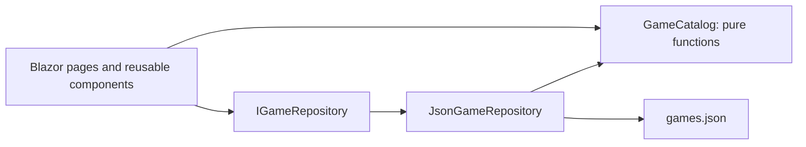

# GameShelf

GameShelf is a personal game library inspired by list trackers: record what you want to play, what you are playing, and what you have finished. Add ratings, hours, notes, and favorites; search and filter the collection; then view progress and genre insights.

**GitHub repository:** [Csadow/GameShelf](https://github.com/Csadow/GameShelf)

The project is a .NET 8 Blazor Web App written in C#. It is designed for the **Introduction to Functional Programming** final project and the separate Blazor project rubric provided with the assignment.

## Run locally

Install the .NET 8 SDK, then from this directory:

```bash
dotnet restore GameShelf.sln
dotnet build GameShelf.sln -m:1
dotnet run --project src/GameShelf.Web/GameShelf.Web.csproj
```

Open the HTTP or HTTPS address printed by the app. The first launch creates six editable demo entries. Data is saved at `src/GameShelf.Web/App_Data/games.json`. Back up that file to keep your collection; remove it only if you want to restore the demo collection. To use a different file, set `GAMESHELF_DATA_FILE` to an absolute path before starting the app.

Run the self-contained tests with:

```bash
dotnet run --project tests/GameShelf.Tests/GameShelf.Tests.csproj
```

The test runner uses only the .NET SDK and checks validation, functional queries, statistics, status transitions, JSON persistence, deletion, and concurrent writes.

For an optional browser test, install Chromium and the Python package in `tests/requirements-browser.txt`, then run `python tests/browser_smoke.py`. This launches the app with an isolated temporary data file and checks the add, details, edit, favorite, search, and delete flows.

## Features

- Add, edit, view details, favorite, and delete games with a confirmation step.
- Track `Want to play`, `Playing`, `Completed`, `Paused`, and `Dropped` states.
- Save platform, genre, score, hours played, and personal notes.
- Search titles, platforms, and genres; filter by status; sort by date, title, score, or hours.
- View a dashboard and insights for completion, ratings, favorites, and genres.
- Use the app at desktop and mobile widths. The covers use local CSS, so no external image service is needed.
- Persist data as JSON by writing a temporary file before replacing the previous file. A semaphore protects updates from concurrent requests in one app process.

## Architecture



`GameShelf.Core` contains immutable `record` models, validation, search, filtering, sorting, statistics, `Result<T>`, and the repository interface. `JsonGameRepository` is the boundary for file I/O. `GameShelf.Web` contains the interactive pages and reusable UI components. `GameShelf.Tests` is a package-free test runner.

The Blazor UI uses **Interactive Server** rendering. Microsoft documents that this mode renders interactive components on the server; WebAssembly runs them in the browser. Server rendering was chosen because it keeps the file storage on the server and needs one C# codebase for this small local project. [Blazor render modes](https://learn.microsoft.com/en-us/aspnet/core/blazor/components/render-modes?view=aspnetcore-8.0)

The JSON store uses `System.Text.Json` from the .NET platform. [Microsoft JSON documentation](https://learn.microsoft.com/en-us/dotnet/standard/serialization/system-text-json/deserialization)

## Functional programming concepts

| Syllabus topic | Implementation |
| --- | --- |
| Immutable data | `GameEntry` and `GameDraft` records in `GameShelf.Core/GameEntry.cs` |
| Pure functions | `GameCatalog.Build`, `Query`, `Summarize`, `TopGenres` |
| LINQ pipelines and higher order functions | Filtering, projection, grouping, and ordering in `GameCatalog` |
| Pattern matching | Status labels and sort selection use switch expressions |
| Result-based error handling | `Result<T>` and validation failures |
| Effect isolation and file streams | `JsonGameRepository` owns serialization and file writes |
| Concurrency | `SemaphoreSlim` serializes file operations within one process |

## Scope and limits

GameShelf is a **single collection** local app. It does not provide accounts, a shared public catalog, online synchronization, or a game database API. The JSON repository is intended for one running app process; a production multiuser service would need a database and authentication. Completion dates and demo dates use the server's local clock.

The syllabus says AI tools require explicit instructor permission and that uncredited or unauthorized AI-generated work may be treated as plagiarism. Follow that rule for any submission, and be ready to explain every part of the code in the oral defense.

Read the [user guide](docs/USER_GUIDE.md) and [developer notes](docs/DEVELOPER.md) for operation and extension details. The [editable project presentation](presentation/GameShelf-Presentation.pptx) covers the required defense topics and includes the team members' full names.
